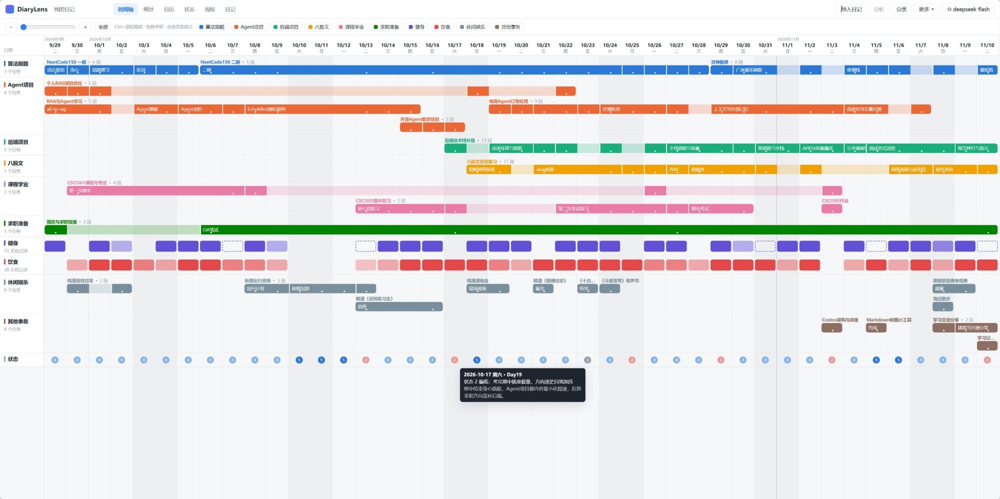
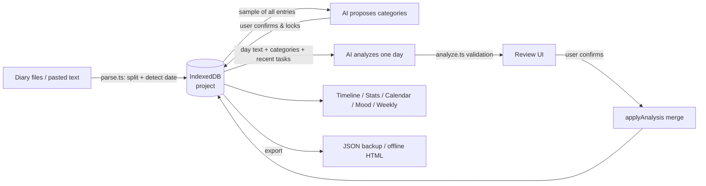
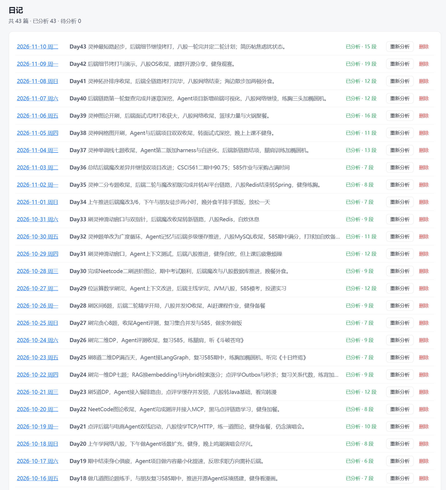
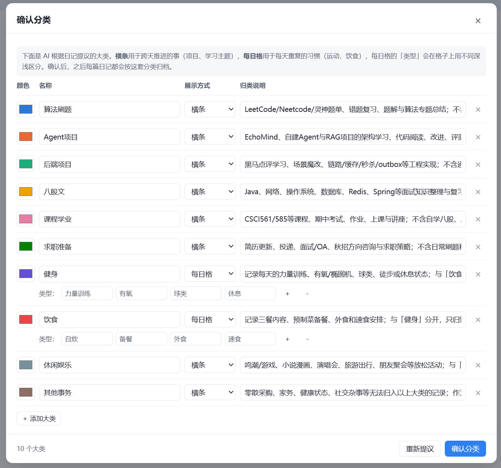
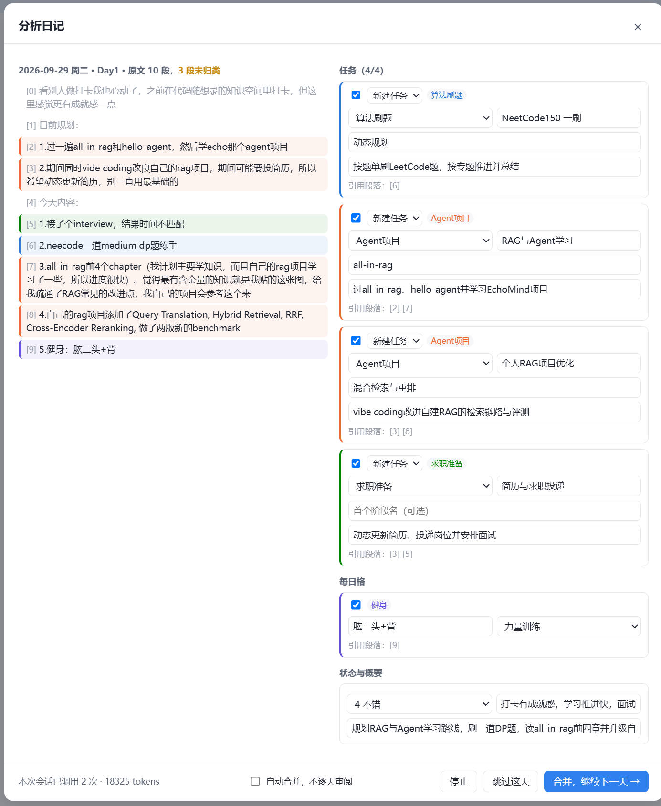
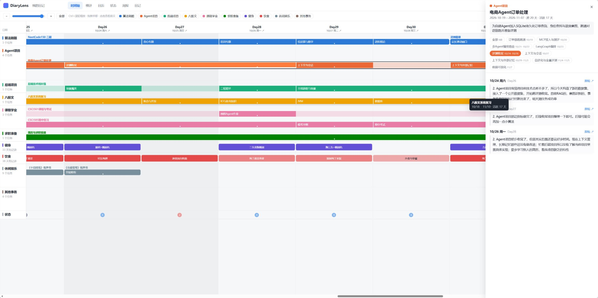
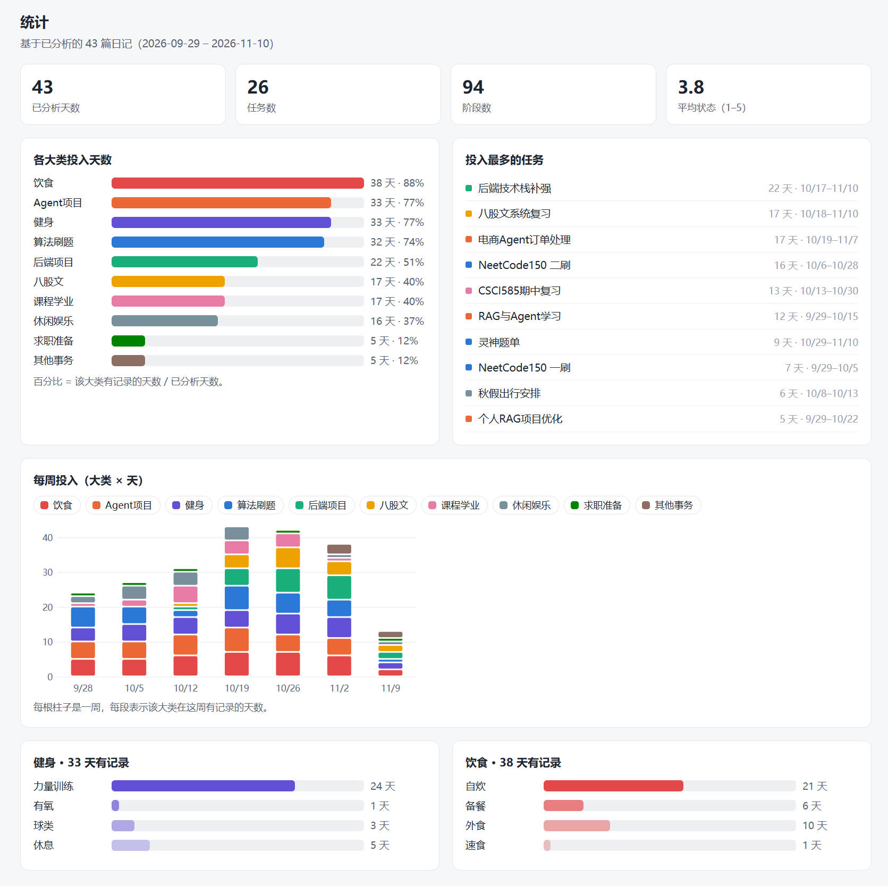
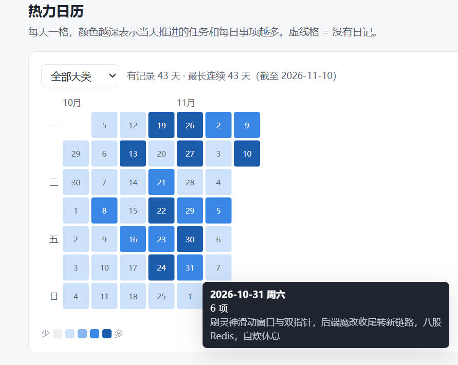
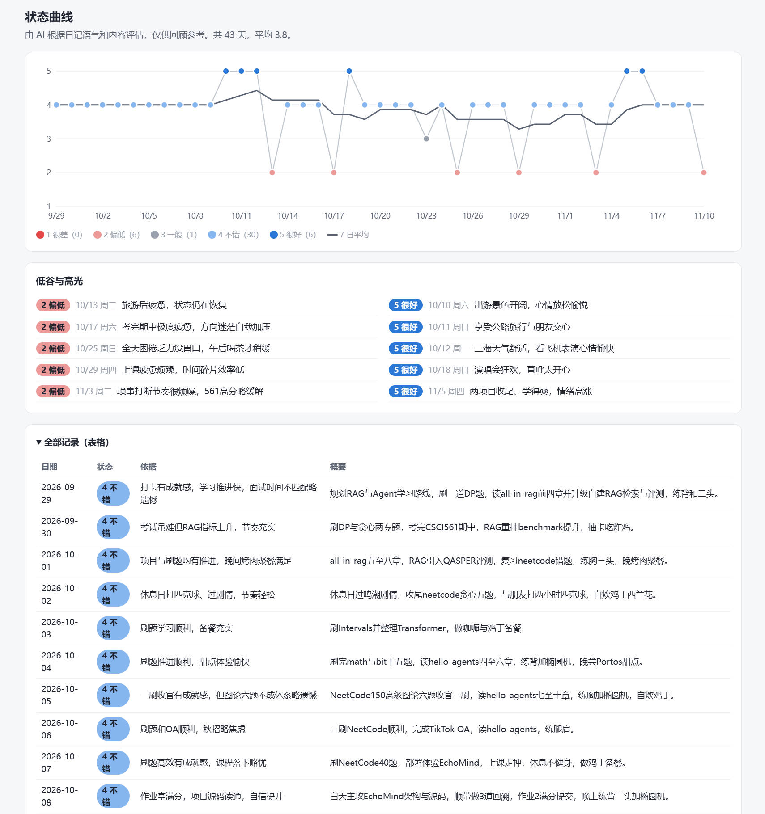
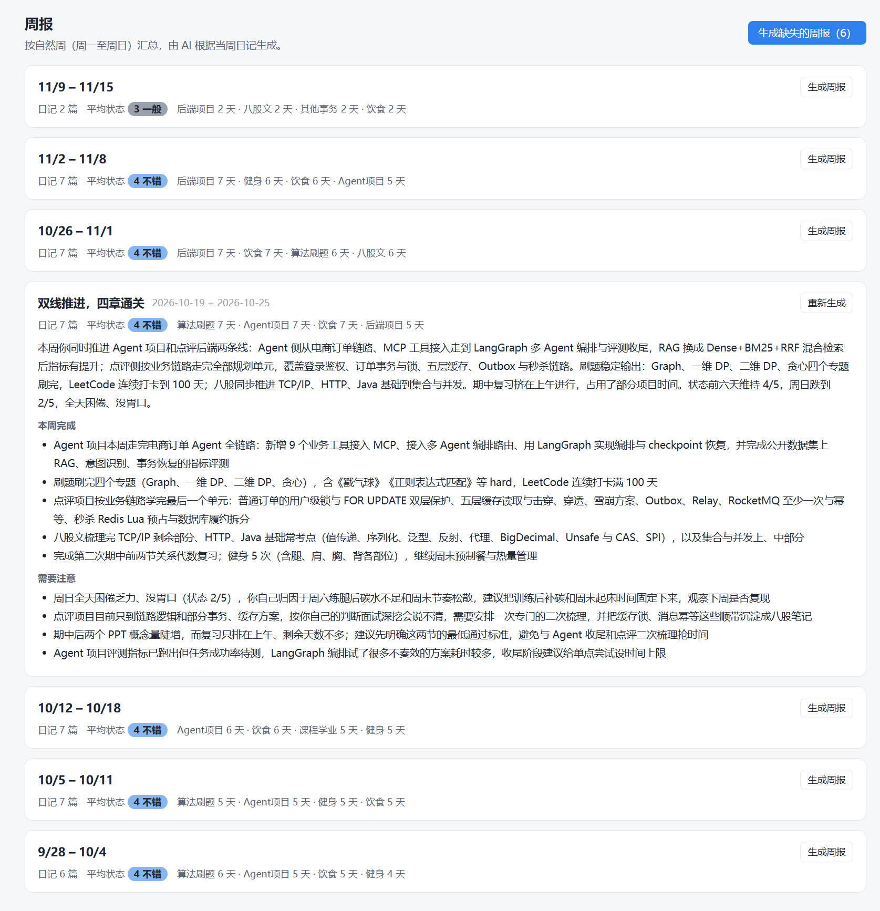

<p align="center">
  
</p>

<h1 align="center">🔍 DiaryLens</h1>

<p align="center">
  Turn your check-in / growth diary into a timeline you can actually see<br>
  <a href="README.md">中文</a> · <b>English</b> · <a href="https://zaughtercoding.github.io/DiaryLens/">Live demo</a>
</p>

---

Import your diary entries, plug in **your own LLM API key** (DeepSeek by default, any OpenAI-compatible endpoint works), and DiaryLens extracts — day by day — which tasks you pushed forward, which stage each one is in, which habits you kept, and how you felt. It then renders an interactive timeline, stats, a heatmap calendar, a mood curve and weekly reviews.

No more pasting diaries into ChatGPT / Claude and chatting back and forth, and no backend: the whole app is one static web page, and your data stays in your browser.

> The UI and the built-in prompts are currently in Chinese; the analysis itself works on diaries in any language the model understands.

<p align="center"></p>

## Contents

- [Features](#features)
- [Quick start](#quick-start)
- [How it works](#how-it-works)
- [Models & privacy](#models--privacy)
- [Diary format](#diary-format)
- [Data model](#data-model)
- [Project layout](#project-layout)
- [Run it locally](#run-it-locally)
- [Roadmap](#roadmap)

## Features

| Feature | What it does |
|---|---|
| 📥 Import | Upload several `.md` / `.txt` files (one per day) or paste text; dates are detected automatically |
| 🗂️ AI-proposed categories | The model reads your diary and proposes categories; you edit and confirm them |
| 🔍 Incremental analysis | Analyzes one day at a time with your existing tasks as context: *continue*, *new stage* or *new task* |
| ✅ Review before merge | Every day's result is shown for review and editing before it is saved; auto-merge is optional |
| 📊 Timeline | Multi-day tasks as bars in auto-assigned lanes, habits as daily cells; click anything to see the source text |
| 📈 Stats | Active days and share per category, weekly stacked bars, top tasks |
| 🗓️ Heatmap calendar | One cell per day shaded by activity, filterable by category, with the longest streak |
| 🙂 Mood curve | A 1–5 mood score per day with the model's reasoning, plus a 7-day average |
| 📝 Weekly review | Summary, achievements and things to watch, per calendar week |
| 💾 Local storage & export | Autosaved in the browser; JSON backup; offline read-only HTML snapshot for sharing |
| 🧪 Demo mode | Try the UI without an API key, using keyword rules in place of a model |

## Quick start

### Use it online

Open **https://zaughtercoding.github.io/DiaryLens/**. It is just a static page: your diary and API key stay in your own browser and are never uploaded to this site.

### Self-host

Prefer not to depend on the hosted site? Clone the project and run it yourself; see [Run it locally](#run-it-locally).

### Workflow

1. **Import**: click 导入日记 (Import) at the top right, upload files or paste text.
2. **Configure the model**: ⚙ → pick a provider → enter your API key → 测试连接 (Test connection).
3. **Confirm categories**: click 生成分类 (Generate categories) and review the proposal.
4. **Analyze**: click 分析 (Analyze), then review and merge each day.

From then on, import each new entry and click Analyze again; only the new days are processed. To look around first, click 加载示例体验 (Load sample) on the welcome screen.

## How it works

### Overview



Everything runs in the browser: `fetch` calls the endpoint you configure directly, data lives in IndexedDB, and Vite plus `vite-plugin-singlefile` inline all JS and CSS into one HTML file.

### 1. Importing and parsing

- One file = one day. **Every non-empty line is a paragraph**, and its index is the paragraph number used to cite the source text later.
- The date is taken from, in order: a metadata line at the top (`- 日期：…`, `date: …`, YAML front matter), then the file name (`2026-09-29.md`, `20260929.txt`), then the first date in the opening lines. The import dialog shows each detected date and where it came from, and you can fix any of them by hand.
- Optional metadata: `Day: 12` is shown as a label and `来源 / source: https://…` as a link to the original post. Hashtag-only lines (`#foo #bar`) and structural headings such as "正文" are ignored.
- Re-importing a date that already exists replaces the entry and clears that day's analysis, because the old paragraph numbers no longer line up.

<p align="center"></p>

### 2. AI-proposed categories

- For large diaries, **up to 40 entries are sampled evenly**, kept to roughly 24k characters, so the whole time range is covered.
- The prompt asks for 6–12 categories, each with a display mode:
  - **bars**: things pushed forward over many days (a study topic, a project, job hunting), broken down into tasks;
  - **daily**: recurring habits (exercise, meals), each day tagged with one of 2–4 types (e.g. strength / cardio / rest).
- The output is normalized: ids become lowercase ASCII and are de-duplicated, every daily category gets at least one type, and colors are assigned in the fixed order of a **color-vision-deficiency-safe categorical palette**.
- Once confirmed, the categories are locked and every later entry is filed under them. A category that is already in use can't be deleted or switch modes, but it can be renamed or recolored.

<p align="center"></p>

### 3. Incremental per-day analysis

This is the core of the project. Each day is one model call, with these inputs:

| Input | Purpose |
|---|---|
| Categories, with descriptions and daily types | Limits where things can be filed |
| **Tasks active in the last 30 days**: id, name, description, stage date ranges, last active day | Lets the model pick which task to continue |
| Older tasks (name and last active day only) | Prevents re-creating tasks that already exist |
| One-line summaries of the previous 3 days | Keeps context continuous |
| The day's text, each paragraph tagged `[n]` | Lets the model cite by paragraph number |

The model returns structured operations:

```jsonc
{
  "ops": [
    { "type": "continue",  "task": "existing-id", "paras": [0, 1] },              // same thing, keeps going
    { "type": "new_stage", "task": "existing-id", "stage": "Graphs", "paras": [2] }, // same task, new phase
    { "type": "new_task",  "cat": "study", "name": "…", "desc": "…", "paras": [3] }   // new direction
  ],
  "daily": [{ "cat": "fit", "label": "Back+biceps", "tag": "gym", "paras": [5] }],
  "mood": 4, "moodNote": "Plan done, upbeat tone", "summary": "…"
}
```

Why it's designed this way:

- **Incremental, not full recomputation**: each call only needs one day's text plus a compact task summary, so token cost per day stays flat as the diary grows, and results you already approved are never changed by a later run.
- **Strictly sequential**: day N is analyzed against the task list after day N−1 was merged, so days are processed in date order.
- **Citing by paragraph number**: the model outputs only indices instead of quoting text, so output stays short and your own words are never rewritten.

### 4. Validation and fault tolerance

Model output isn't trusted as-is; `analyze.ts` checks every field:

- `response_format: json_object` is used when the provider supports it. JSON is still extracted if the model wraps it in \`\`\`json or adds text around it, and a parse failure is sent back to the model for **one automatic retry**.
- Paragraph numbers must be integers in `[0, count)`. Operations that point to unknown task ids are dropped, and a new task with an invalid category falls back to the last bar category (usually the catch-all one).
- A daily type must belong to its category, otherwise the first type is used. Only one cell per category per day is kept, and duplicates have their paragraphs merged.
- Mood scores are clamped to 1–5 and text fields are truncated to sensible lengths.

### 5. Review and merge

- In the review dialog, the source text is on the left with **each paragraph colored by the category it was filed under**; unfiled paragraphs stay gray, so anything missed is easy to spot. On the right, every operation can be:
  - switched on or off;
  - changed to another type (continue / new stage / new task);
  - pointed at a different task or category, or renamed (task and stage names);
  - for daily cells, given a different label or type; the day's mood score and summary can be edited too.
- Merging (`applyAnalysis`) **first clears everything previously filed for that day**, so re-analyzing any day is idempotent and never creates duplicates.
- Stage start and end dates aren't stored. They're derived from the dates of the paragraphs that cite the stage: the earliest citation is the start, the latest is the end. Deleting or re-analyzing a day shrinks the bars automatically, with no stale data left behind.

<p align="center"></p>

### 6. Timeline

- The x-axis covers every day from the first entry to the last. Days without an entry are hatched and weekends are shaded.
- **Lane assignment**: within a category, tasks are sorted by start date and greedily placed in the first lane that doesn't overlap, so tasks running in parallel automatically stack into rows.
- A bar is made of its stages laid end to end. Zoomed out, it shows the task name and "▸ N segments"; stage names appear once they fit. Dots on the bar mark the days that actually have entries.
- Zoom is logarithmic (8–360 px per day). Ctrl + wheel zooms around the cursor, dragging pans, and the keys `+` `-` `0` work too.
- Clicking a task, stage, daily cell, date or category opens a side panel listing the **source paragraphs** by date, with a link to the original post.

<p align="center"></p>

### 7. Stats, heatmap and mood

- **Stats**: all task citations and daily cells are first aggregated into "day → categories touched / items / paragraphs". From that come active days per category, weekly stacked bars and a ranking of tasks by active days.
- **Heatmap**: weeks laid out as columns, one cell per day, shaded by the number of items pushed forward. The shade levels are the **quartiles** of all non-zero values, so a few very busy days don't wash everything else out. It can be filtered to a single category and computes the longest streak. Over short ranges the cells grow and show the day number.
- **Mood curve**: daily scores are connected only across consecutive days (gaps break the line), with a 7-day rolling mean on top for the trend. Hovering shows the reasoning and the day's summary; below the chart are the lowest and highest days, plus the full data table.
- Colors follow data-viz guidelines: a fixed-order CVD-safe categorical palette, a single-hue light-to-dark ramp for the heatmap, and a red–gray–blue diverging scale with a neutral midpoint for mood.

<p align="center"></p>
<p align="center">&nbsp;&nbsp;</p>

### 8. Weekly review

Grouped by calendar week (Monday to Sunday). The input is that week's entries, the mood scores, and the tasks and stages touched during the week. The model returns a title, a 3–5 sentence summary, achievements, and things to watch. You can generate one week at a time or fill in every missing week at once.

<p align="center"></p>

### 9. Storage and export

- **Autosave**: the project is written to IndexedDB after every change (200 ms debounce).
- **Project JSON**: a full backup that can be restored in another browser or on another machine.
- **Offline HTML**: on startup, before touching the DOM, the app keeps a copy of its own original HTML. On export, the project data is injected into that copy as `window.__DIARYLENS_EMBED__`, producing a self-contained file. When that file is opened, the app sees the embedded data and switches to **read-only mode**: import, analysis and settings are hidden, and nothing is written to IndexedDB.

## Models & privacy

- The browser calls `{Base URL}/chat/completions` on the endpoint you configure **directly, with no intermediate server**.
- By default the API key is stored in this browser's localStorage. Untick "remember key" to keep it in sessionStorage instead, so it is cleared when the page closes.
- Diary text is sent to the provider you choose for analysis; check that provider's privacy policy.
- The provider must allow cross-origin requests from the browser (CORS). DeepSeek is confirmed to work; a "network request failed" error from another provider is most likely CORS.
- Built-in presets: DeepSeek (default `deepseek-flash`), Kimi, Qwen (DashScope), OpenAI, and custom. If a provider rejects `response_format`, turn off JSON mode in the settings.

**Usage**: one call to propose categories; one call per day for analysis (usually 2k–6k tokens); one call per weekly review. The review dialog shows the running token total for the session.

## Diary format

Plain text works. Here's an example with all optional metadata:

```markdown
# Check-in Day 1

- Day: 1
- date: 2026-09-29
- source: https://example.com/post/1

Solved two DP problems today…
Gym: back + biceps
#hashtag
```

## Data model

```jsonc
{
  "version": 1,
  "entries":    [{ "date": "2026-09-29", "label": "Day1", "url": "…", "paras": ["…"] }],
  "categories": [{ "id": "study", "name": "Study", "mode": "bars", "color": "#2a78d6" },
                 { "id": "fit", "name": "Fitness", "mode": "daily", "tags": [{ "id": "gym", "name": "Strength" }] }],
  "tasks":      [{ "id": "t_x", "cat": "study", "name": "NeetCode150", "segments": [
                   { "name": "Dynamic programming", "refs": { "2026-09-29": [1, 2] } } ] }],
  "daily":      [{ "cat": "fit", "date": "2026-09-29", "label": "Back+biceps", "tag": "gym", "paras": [5] }],
  "days":       { "2026-09-29": { "mood": 4, "moodNote": "…", "summary": "…", "analyzedAt": 0 } },
  "weekly":     { "2026-09-28": { "title": "…", "summary": "…", "highlights": [], "concerns": [] } }
}
```

## Project layout

```
src/
  main.ts        app shell, routing, export
  types.ts       data types
  store.ts       project state, IndexedDB persistence, merging analysis results
  parse.ts       diary parsing and date detection
  llm.ts         OpenAI-compatible client, provider presets, JSON extraction & retry
  prompts.ts     category / per-day / weekly prompts
  analyze.ts     model calls and output validation
  mock.ts        demo mode
  ui/            dialogs: settings, import, categories, review, analysis flow
  views/         timeline, stats, calendar, mood, weekly, entries, detail panel
  samples/       sample diary (fictional)
  assets/        icon
```

Built with TypeScript and Vite. No UI framework and no chart library; every chart is hand-written SVG.

## Run it locally

If you'd rather not use the hosted site, clone the project and run it on your own machine. It works exactly like the online version, and every request still goes straight from your browser to the model provider you configure.

### Prerequisites

- [Node.js](https://nodejs.org/) 18 or later (includes npm)
- Git

### Option 1: dev server (recommended)

```bash
git clone https://github.com/zaughterCoding/DiaryLens.git
cd DiaryLens
npm install
npm run dev
```

Open the URL printed in the terminal (http://localhost:5173 by default). The page reloads automatically when you edit the source.

### Option 2: build a single HTML file for offline use

```bash
git clone https://github.com/zaughterCoding/DiaryLens.git
cd DiaryLens
npm install
npm run build
```

The result is `dist/index.html`, with all code and styles inlined. From then on you need neither Node.js nor a server:

- double-click `dist/index.html` to open it in your browser;
- or copy it anywhere (a USB stick, another computer) and use it there.

To preview the build on a local server, run `npm run preview` (http://localhost:4173 by default).

### Notes

- **Data is per URL**: browsers store data separately for each origin, so `localhost:5173`, `localhost:4173`, a double-clicked local file and the hosted site don't share data. To move a project between them, use 更多 → 导出项目 JSON (More → Export project JSON) and then 导入项目 JSON (Import project JSON).
- **Opening the file directly**: Chrome and Edge save data fine from a local file. Some browsers restrict storage for `file://` pages; if yours does, use `npm run preview` instead.
- **Offline**: the page itself opens offline; analyzing entries and generating weekly reviews need access to your model endpoint (except in demo mode).
- **Deploy your own copy**: fork the repo, set Settings → Pages → Source to GitHub Actions, and every push to `main` deploys to your own GitHub Pages. Alternatively, put `dist/index.html` on any static host.

## Roadmap

- [ ] Full rebuild: re-analyze every entry under the current categories
- [ ] Manually merge, split and edit tasks
- [ ] Split a single file containing several days
- [ ] Native Anthropic and Gemini APIs
