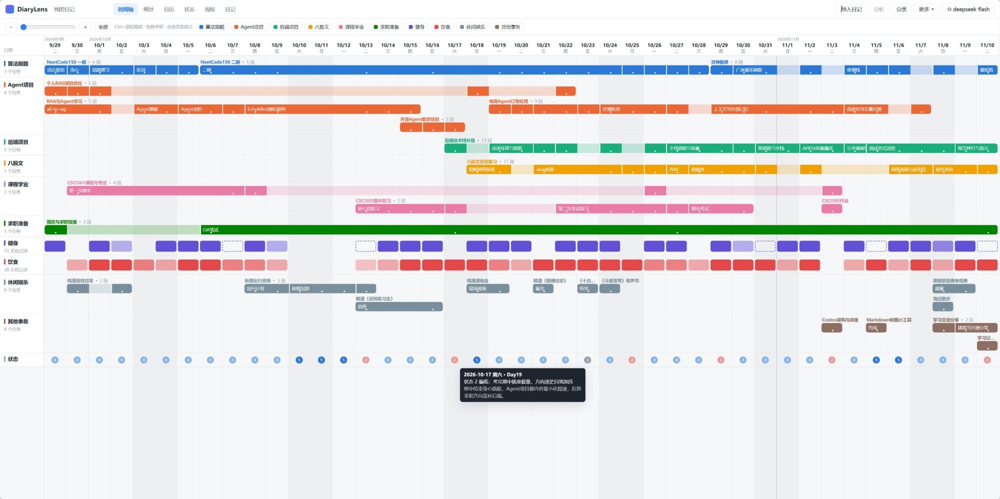
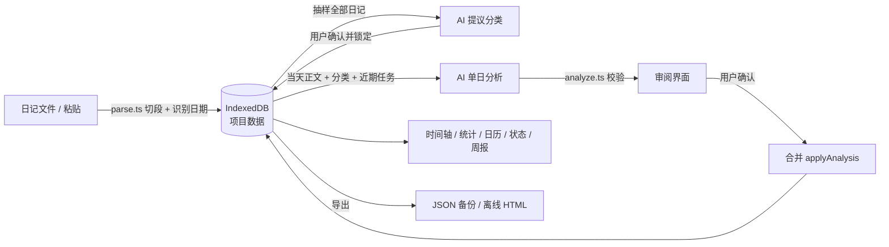
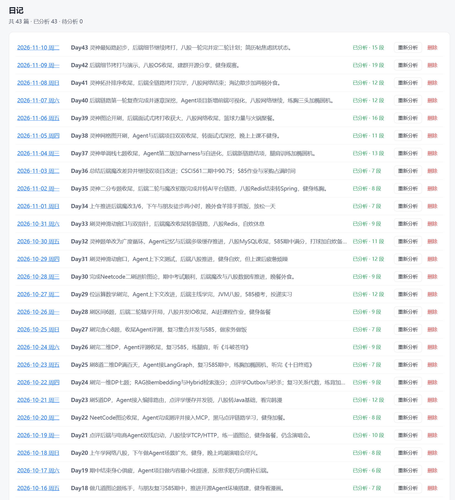
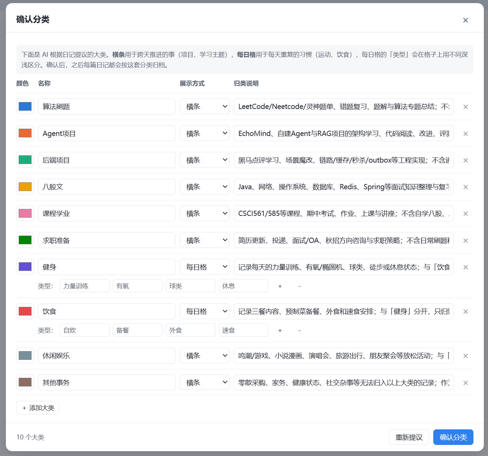
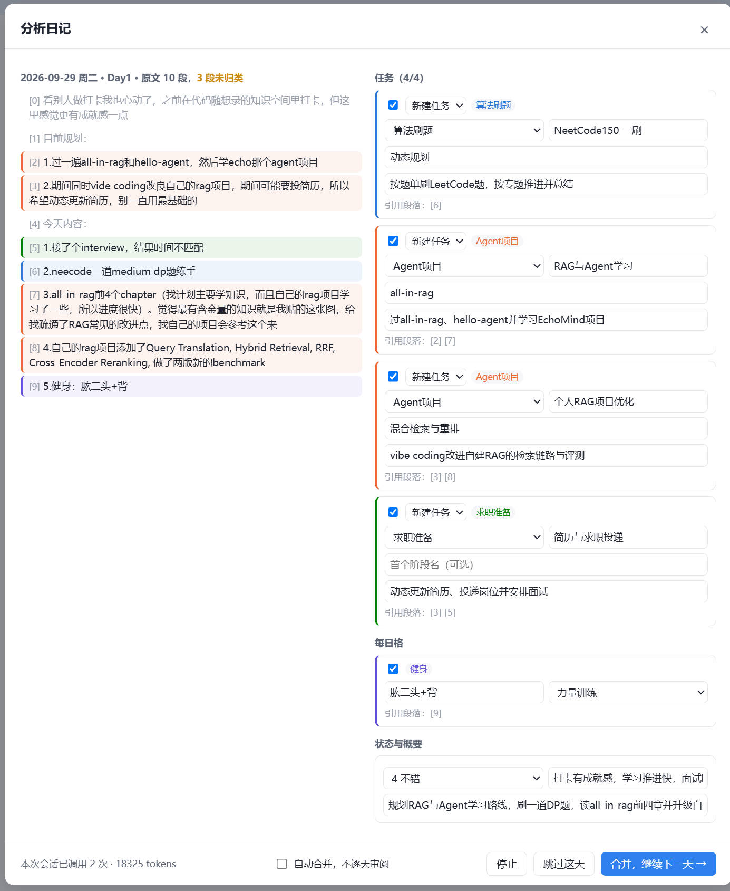
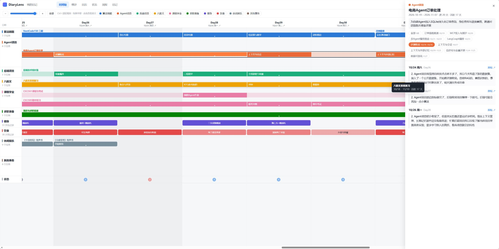
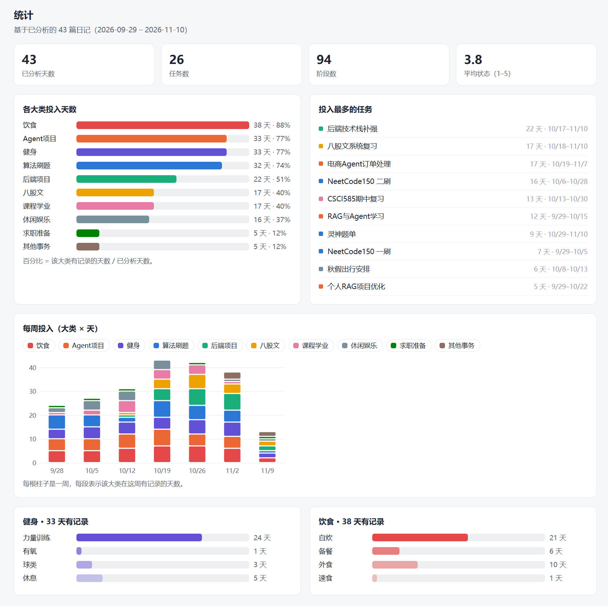
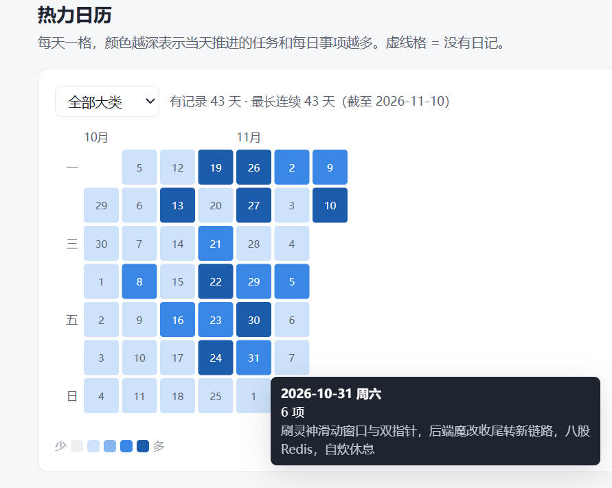
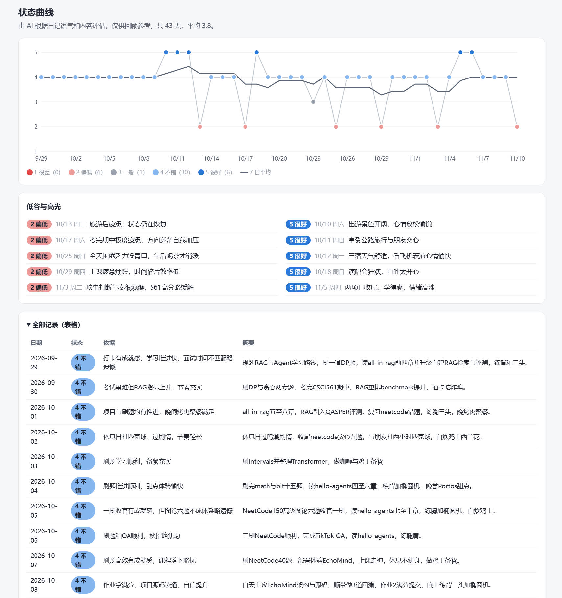
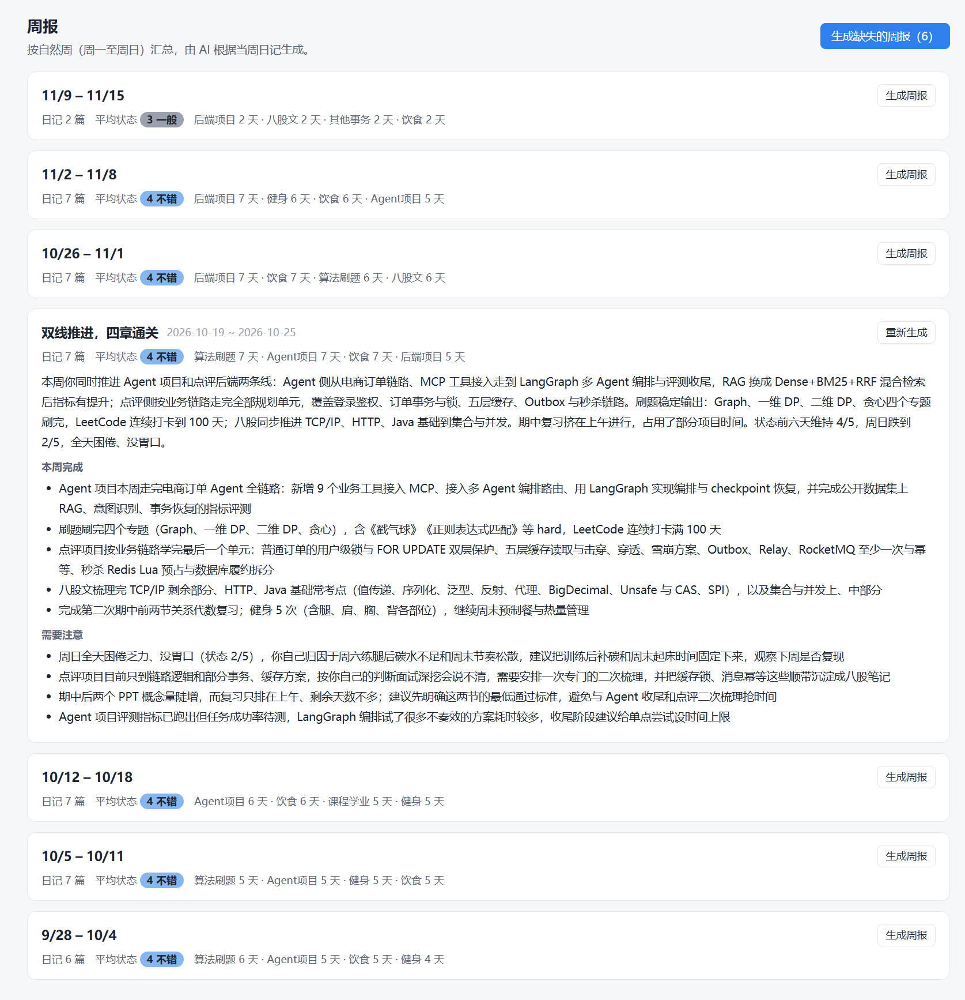

<p align="center">
  
</p>

<h1 align="center">🔍 DiaryLens 日记透镜</h1>

<p align="center">
  把打卡 / 成长日记变成一条看得见的时间轴<br>
  <b>中文</b> · <a href="README.en.md">English</a> · <a href="https://zaughtercoding.github.io/DiaryLens/">在线体验</a>
</p>

---

导入日记正文，填上**你自己的大模型 API Key**（默认 DeepSeek，任何 OpenAI 兼容接口都可以），DiaryLens 会逐天提取你推进了哪些任务、处在什么阶段、坚持了哪些习惯、状态如何，再生成可交互的时间轴、统计图、热力日历、状态曲线和周报。

不用在 ChatGPT / Claude 里反复粘贴日记、对话，也不需要后端服务器：整个应用是一个静态网页，数据只存在你的浏览器里。

<p align="center"></p>

## 目录

- [功能一览](#功能一览)
- [快速开始](#快速开始)
- [功能详解与实现原理](#功能详解与实现原理)
- [模型与隐私](#模型与隐私)
- [日记格式](#日记格式)
- [数据结构](#数据结构)
- [代码结构](#代码结构)
- [本地运行](#本地运行)
- [后续计划](#后续计划)

## 功能一览

| 功能 | 说明 |
|---|---|
| 📥 导入日记 | 上传多个 `.md` / `.txt`（一天一个文件）或直接粘贴，自动识别日期 |
| 🗂️ AI 提议分类 | 模型通读日记后提议一套大类，由你增删改后确认 |
| 🔍 增量分析 | 逐天分析，参考已有任务，判断是「延续」「新阶段」还是「新任务」 |
| ✅ 审阅后合并 | 每天的结果先给你审阅、修改，确认后才写入；也可以开启自动合并 |
| 📊 时间轴 | 跨天任务画成横条并自动分泳道，习惯画成每日格，点击可回看原文 |
| 📈 统计 | 各大类投入天数与占比、每周投入堆叠图、投入最多的任务 |
| 🗓️ 热力日历 | 每天一格表示活动强度，可按大类筛选，显示最长连续天数 |
| 🙂 状态曲线 | AI 给每天的状态打 1–5 分并给出依据，附 7 日平均 |
| 📝 周报 | 按自然周生成总结、本周完成和需要注意的地方 |
| 💾 本地存储与导出 | 浏览器自动保存；导出 JSON 备份；导出离线 HTML 只读快照用于分享 |
| 🧪 演示模式 | 不需要 API Key，用关键词规则模拟分析，先体验界面 |

## 快速开始

### 在线使用

直接打开 **https://zaughtercoding.github.io/DiaryLens/** 即可。这只是一个静态网页：你的日记和 API Key 都保存在你自己的浏览器里，不会上传到这个网站。

### 自己运行

不想依赖在线网站，可以把项目 clone 到本地自己运行，见下文[本地运行](#本地运行)。

### 使用流程

1. **导入日记**：右上角「导入日记」，上传文件或粘贴正文。
2. **配置模型**：⚙ → 选择服务商 → 填 API Key → 「测试连接」。
3. **确认分类**：点「生成分类」，审阅 AI 提议的大类。
4. **分析**：点「分析」，逐天审阅后合并。

之后每写一篇新日记，导入后再点「分析」即可，只会处理新增的那几天。想先看效果，可以点首页的「加载示例体验」。

## 功能详解与实现原理

### 整体流程



整个应用是纯前端：浏览器直接用 `fetch` 请求你填写的模型接口；数据存在 IndexedDB 里；Vite 用 `vite-plugin-singlefile` 把所有 JS、CSS 内联进一个 HTML 文件。

### 1. 导入与解析日记

- 每个文件对应一天，正文**每个非空行算一个段落**，段落下标就是之后引用原文用的段落号。
- 日期按优先级识别：正文开头的元数据行（`- 日期：…`、`date: …`、YAML front matter）→ 文件名（`2026-09-29.md`、`20260929.txt`）→ 正文前几行里出现的日期。导入前会列出每个文件识别到的日期和来源，识别失败或识别错的可以手动改。
- 会额外提取一些元数据：`Day：12` 显示为标签，`来源：https://…` 显示为原帖链接。纯话题标签行（`#xxx #yyy`）和「正文」这类结构性标题会被忽略。
- 导入的日期已经存在时会覆盖，并清掉这一天原来的分析结果，因为旧的段落号已经对不上了。

<p align="center"></p>

### 2. AI 提议分类

- 日记较多时，**均匀抽取最多 40 篇**，总长度控制在约 24k 字以内，确保覆盖整个时间段。
- 提示词要求模型给出 6–12 个大类，并为每个大类选择展示方式：
  - **横条（bars）**：跨多天推进的事，如学习主题、项目、求职，下面再细分为任务；
  - **每日格（daily）**：每天重复的习惯，如运动、饮食，用 2–4 个「类型」区分当天情况（例如力量 / 有氧 / 休息）。
- 模型输出会被规范化：id 统一转成小写英文，去重；每日格类至少有一个类型；颜色按一套**经过色觉障碍校验的分类色顺序**依次分配。
- 分类确认后锁定，之后每篇日记都按这套分类归档。已被使用的大类不能删除，也不能切换展示方式，但可以改名、改颜色。

<p align="center"></p>

### 3. 单日增量分析

这是项目的核心。每天调用一次模型，输入包括：

| 输入 | 作用 |
|---|---|
| 大类列表（含说明和每日格类型） | 限定可用的归类 |
| **近 30 天活跃的任务**：id、名称、描述、各阶段起止日期、最近活跃日 | 让模型判断应该延续哪个任务 |
| 更早的任务（只给名称和最近活跃日） | 避免重复新建早已存在的任务 |
| 前 3 天的一句话概要 | 提供上下文的连续性 |
| 当天正文，每段带 `[编号]` | 按段落号引用原文 |

模型返回三类结构化操作：

```jsonc
{
  "ops": [
    { "type": "continue",  "task": "已有任务id", "paras": [0, 1] },            // 同一件事继续推进
    { "type": "new_stage", "task": "已有任务id", "stage": "图论", "paras": [2] }, // 同一任务进入新阶段
    { "type": "new_task",  "cat": "study", "name": "…", "desc": "…", "paras": [3] } // 新方向
  ],
  "daily": [{ "cat": "fit", "label": "背+二头", "tag": "gym", "paras": [5] }],
  "mood": 4, "moodNote": "完成计划，语气积极", "summary": "……"
}
```

为什么这样设计：

- **增量而不是每次全量重算**：每天只需要当天正文和一份压缩后的任务摘要，token 消耗基本恒定，不会随日记变多而增长；已经确认过的历史结果也不会被下一次分析改动。
- **必须串行**：第 N 天的分析依赖前 N−1 天合并后的任务列表，所以按日期顺序一天一天处理。
- **用段落号引用原文**：模型只输出编号，不复述原文，输出更短，也不会改写你的原话。

### 4. 输出校验与容错

模型的输出不能直接信任，`analyze.ts` 会逐项检查：

- 支持 `response_format: json_object`；即使模型用 \`\`\`json 包裹或者前后带了说明文字，也能提取出 JSON。解析失败时，会把错误反馈给模型**自动重试一次**。
- 段落号必须是整数，且在 `[0, 段落数)` 范围内；引用了不存在的任务 id 的操作会被丢弃；新任务的大类不合法时会退回到兜底大类。
- 每日格的类型必须是该大类已定义的类型，否则用第一个；同一大类同一天只保留一格，重复的会合并段落。
- 状态分数会限制在 1–5，文本字段会截断到合理长度。

### 5. 审阅与合并

- 审阅界面左侧是原文，**每段按归入的大类着色**，没有归类的段落显示为灰色，一眼就能看出遗漏；右侧每条操作都可以：
  - 勾选或取消；
  - 切换类型（延续 / 新阶段 / 新任务）；
  - 改目标任务、改大类、改名称和阶段名；
  - 改每日格的标签、类型，以及当天的状态分数和概要。
- 合并（`applyAnalysis`）时会**先清掉这一天原有的全部归类再写入**，所以对任意一天「重新分析」都可以重复执行，不会产生重复数据。
- 阶段的起止日期不单独存储，而是由引用它的段落日期推导：最早引用日就是起点，最晚引用日就是终点。删除或重新分析某天后，横条会自动收缩，不会留下脏数据。

<p align="center"></p>

### 6. 时间轴

- 横轴是从第一篇到最后一篇日记的每一天，没有日记的日子用斜线标出，周末加底色。
- **泳道分配**：同一大类下的任务按开始日期排序，用贪心算法放进第一条不冲突的泳道，并行推进的任务会自动分成多行。
- 横条由多个阶段段落拼接而成：缩小时只显示任务名和「▸ N 段」，放大到阶段名放得下时才显示每段的名称；条上的小圆点表示实际有记录的日子。
- 缩放用对数刻度（每天 8–360 像素），支持 Ctrl + 滚轮以鼠标位置为中心缩放、拖拽平移、键盘 `+` `-` `0`。
- 点击任务、阶段、每日格、日期或大类名，右侧会打开详情栏，按日期列出对应的**原文段落**，并附原帖链接。

<p align="center"></p>

### 7. 统计、热力日历、状态曲线

- **统计**：先把所有任务引用和每日格汇总成「每天 → 涉及的大类 / 事项数 / 段落数」，再统计各大类的活跃天数、每周的堆叠柱状图，以及按活跃天数排序的任务榜。
- **热力日历**：按周排列，每天一格，颜色深浅表示当天推进的事项数。档位按所有非零值的**四分位数**划分，避免个别特别忙的日子把其他日子都压成浅色。可以按单个大类筛选，并计算最长连续记录天数。时间跨度短时，格子会自动放大并显示日期。
- **状态曲线**：画出每天的状态分数，连续的日子连线，缺失的日子断开，另外叠加 7 日滑动平均来看趋势。悬停显示评分依据和当天概要，并列出低谷和高光日，以及完整的数据表格。
- 配色遵循数据可视化规范：分类用固定顺序的色盲友好色；热力图用单色由浅到深；状态用红—灰—蓝发散色，中点是中性灰。

<p align="center"></p>
<p align="center">&nbsp;&nbsp;</p>

### 8. 周报

按自然周（周一到周日）汇总。输入包括当周每天的正文、状态评分，以及「当周推进过的任务和阶段」。模型输出标题、3–5 句总结、本周完成的事和需要注意的地方。可以单周生成，也可以一键补齐所有缺失的周报。

<p align="center"></p>

### 9. 存储与导出

- **自动保存**：项目数据在每次变更后（200 ms 防抖）写入 IndexedDB。
- **项目 JSON**：完整备份，可以在其他浏览器或电脑上导入恢复。
- **离线 HTML**：应用启动时，在改动 DOM 之前先保存一份页面原始 HTML。导出时，把项目数据作为 `window.__DIARYLENS_EMBED__` 注入这份 HTML，得到一个自包含的文件。打开时检测到嵌入数据，就进入**只读模式**：隐藏导入、分析、设置，也不写入 IndexedDB。

## 模型与隐私

- 浏览器直接请求你填写的接口 `{Base URL}/chat/completions`，**不经过任何中间服务器**。
- API Key 默认保存在本浏览器的 localStorage 里；取消「记住 Key」后改存 sessionStorage，关闭页面即清除。
- 日记正文会发送给你选择的模型服务商用于分析，请自行评估该服务商的隐私政策。
- 服务商需要允许浏览器跨域调用（CORS），DeepSeek 已确认可用。其他服务商如果报「网络请求失败」，多半是 CORS 限制。
- 内置预设有 DeepSeek（默认 `deepseek-flash`）、Kimi、通义千问、OpenAI 和自定义。服务商不支持 `response_format` 时，在设置里关闭「JSON 输出模式」。

**用量参考**：生成分类 1 次调用；每天分析 1 次，通常 2k–6k tokens；周报每周 1 次。审阅界面底部会显示本次会话累计用了多少 tokens。

## 日记格式

纯文本即可，下面是一个包含全部可选元数据的例子：

```markdown
# 打卡 Day1

- Day：1
- 日期：2026/09/29
- 来源：https://example.com/post/1

## 正文

今天刷了两道 DP 题……
健身：背 + 二头
#话题标签
```

## 数据结构

```jsonc
{
  "version": 1,
  "entries":    [{ "date": "2026-09-29", "label": "Day1", "url": "…", "paras": ["…"] }],
  "categories": [{ "id": "study", "name": "学习", "mode": "bars", "color": "#2a78d6" },
                 { "id": "fit", "name": "运动", "mode": "daily", "tags": [{ "id": "gym", "name": "力量" }] }],
  "tasks":      [{ "id": "t_x", "cat": "study", "name": "NeetCode150", "segments": [
                   { "name": "动态规划", "refs": { "2026-09-29": [1, 2] } } ] }],
  "daily":      [{ "cat": "fit", "date": "2026-09-29", "label": "背+二头", "tag": "gym", "paras": [5] }],
  "days":       { "2026-09-29": { "mood": 4, "moodNote": "…", "summary": "…", "analyzedAt": 0 } },
  "weekly":     { "2026-09-28": { "title": "…", "summary": "…", "highlights": [], "concerns": [] } }
}
```

## 代码结构

```
src/
  main.ts        应用外壳、路由、导出
  types.ts       数据类型
  store.ts       项目状态、IndexedDB 持久化、合并分析结果
  parse.ts       日记解析与日期识别
  llm.ts         OpenAI 兼容客户端、服务商预设、JSON 提取与重试
  prompts.ts     分类 / 单日 / 周报提示词
  analyze.ts     调用模型并校验输出
  mock.ts        演示模式
  ui/            弹窗：设置、导入、分类、审阅、分析流程
  views/         时间轴、统计、日历、状态、周报、日记列表、详情侧栏
  samples/       示例日记（虚构）
  assets/        图标
```

技术栈：TypeScript + Vite，没有使用 UI 框架和图表库，图表都是手写 SVG。

## 本地运行

如果你不想使用在线网站，可以 clone 本项目，在自己电脑上运行。本地运行和在线版功能完全一样，所有请求都由你的浏览器直接发给你配置的模型服务商。

### 准备

- [Node.js](https://nodejs.org/) 18 或更高版本（自带 npm）
- Git

### 方式一：开发模式（推荐）

```bash
git clone https://github.com/zaughterCoding/DiaryLens.git
cd DiaryLens
npm install
npm run dev
```

浏览器打开终端里显示的地址（默认 http://localhost:5173）。修改源码后页面会自动刷新。

### 方式二：打包成单个 HTML，离线使用

```bash
git clone https://github.com/zaughterCoding/DiaryLens.git
cd DiaryLens
npm install
npm run build
```

打包产物是 `dist/index.html`，所有代码和样式都内联在这个文件里。之后不再需要 Node.js，也不需要服务器：

- 直接双击 `dist/index.html` 用浏览器打开；
- 或者复制到任意位置、U 盘、其他电脑上使用。

想用本地服务器预览打包结果，可以运行 `npm run preview`（默认 http://localhost:4173）。

### 注意事项

- **数据按网址隔离**：浏览器按网址（来源）分别保存数据，`localhost:5173`、`localhost:4173`、双击打开的本地文件、在线网站之间互不共享。要在它们之间迁移，请用「更多 → 导出项目 JSON」再「导入项目 JSON」。
- **双击打开的文件**：Chrome / Edge 可以正常保存数据；个别浏览器对本地文件（`file://`）的存储有限制，遇到时请改用 `npm run preview`。
- **离线**：页面本身可以离线打开；分析日记和生成周报需要能访问你配置的模型接口（演示模式除外）。
- **自己部署**：fork 本仓库后，在 Settings → Pages 把 Source 设为 GitHub Actions，推送到 `main` 分支即可自动部署到你自己的 GitHub Pages。也可以把 `dist/index.html` 放到任意静态托管服务上。

## 后续计划

- [ ] 全量重建：用当前分类把所有日记重新分析一遍
- [ ] 手动合并、拆分、编辑任务
- [ ] 单个文件包含多天日记时自动切分
- [ ] Anthropic、Gemini 原生接口
